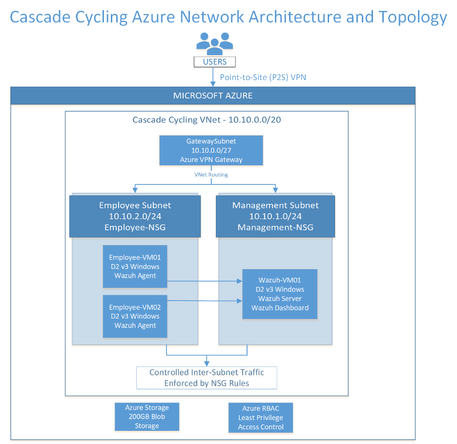

# Network Architecture

This folder contains the network diagrams and architecture information for the Cascade Cycling Azure environment.

The network includes separate subnets for employee and management virtual machines, along with Azure Firewall and Network Security Groups (NSGs) to control network traffic. Wazuh is hosted in a separate virtual network and is connected through VNet peering.

## Virtual Networks and Subnets

The Azure environment uses two virtual networks in separate regions. The main Cascade Cycling network is located in West US 2, while the Wazuh monitoring server is hosted in West US 3.

### Cascade Cycling VNet

- **VNet:** CascadeCycling
- **Region:** West US 2
- **Address Space:** 10.10.0.0/20

| Subnet | Address Range | Purpose |
|---|---|---|
| ManagementSubnet | 10.10.1.0/24 | Management virtual machine |
| EmployeeSubnet | 10.10.2.0/24 | Employee virtual machines |
| AzureBastionSubnet | 10.10.3.0/26 | Reserved for Azure Bastion |
| AzureFirewallSubnet | 10.10.4.0/26 | Azure Firewall |

### Wazuh VNet

- **Region:** West US 3
- **Subnet Address Range:** 172.16.0.0/24
- **Server:** Wazuh-Linux-VM01

The two virtual networks are connected through VNet peering, allowing communication between the employee virtual machines and the Wazuh monitoring server. Network traffic to Wazuh is routed through Azure Firewall.

## Proposed Network Architecture

The diagram below shows the original network design for Cascade Cycling. Some components and configurations were adjusted during deployment.

